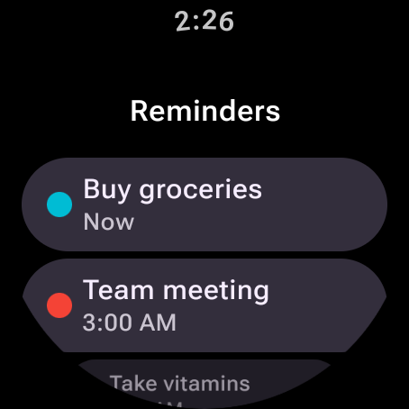
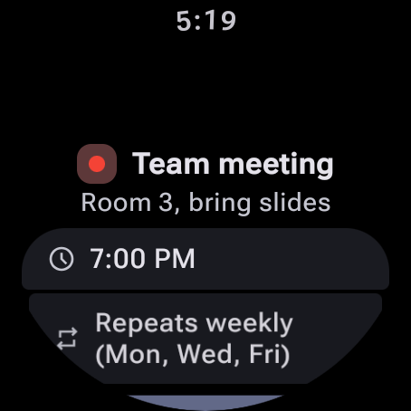
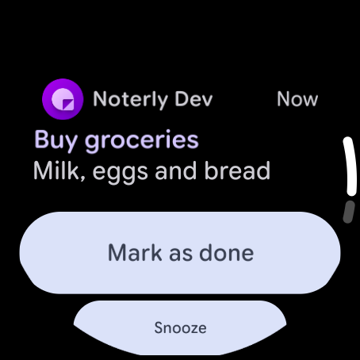
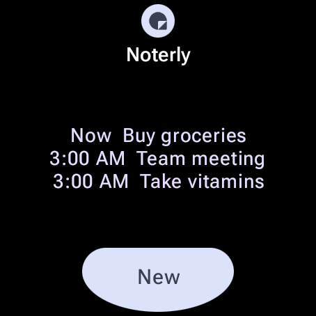

# Noterly Watch

[English](README.md) | **한국어**

[Noterly](https://github.com/lhh9799/noterly) 폰 앱의 알림을 Galaxy Watch(Wear OS)에서 보고 처리하는 워치 앱입니다. 폰을 꺼내지 않고 손목에서 알림을 받고, 완료·스누즈하고, 새 알림을 추가할 수 있습니다.

> 원작 [Noterly](https://github.com/tomc128/noterly)(Tom Chapman, TDS Studios)를 바탕으로 만든 **개인 포크**이며, TDS Studios와는 관계가 없습니다. 라이선스는 [아래](#라이선스)를 보세요.

<p>
  
  
  
  
</p>

## 기능

- **알림 목록**: 폰의 알림이 그대로 보이고, 폰처럼 Shown immediately·Scheduled·Repeating으로 나뉘며 각각 다음 알림 시각 순으로 정렬됩니다. 반복 알림은 다음 몇 회차를 함께 보여 줍니다.
- **워치 알림**: 정해진 시각에 워치가 직접 진동과 함께 알림을 띄웁니다. 폰이 멀리 있거나 꺼져 있어도 울립니다.
- **완료·스누즈**: 알림이나 상세 화면에서 바로 처리하면 폰에도 반영됩니다. 반복 알림은 다음 회차로 넘어갑니다.
- **추가·편집**: 제목, 시각(없으면 바로 알림), 반복(매일·매주·요일 선택 등), 색상을 워치에서 정할 수 있습니다.
- **보관함**: 완료한 알림을 보고 복원하거나 삭제할 수 있습니다.
- **타일과 컴플리케이션**: 워치 페이스와 타일에서 다음 알림을 바로 확인합니다.
- **오프라인**: 폰과 연결이 끊겨도 워치에서 한 일은 저장해 두었다가 다시 연결되면 폰에 반영합니다.

## 꼭 알아 둘 점

- **폰에 Noterly 앱이 있어야 동작합니다.** 워치 앱 설치 자체는 폰 앱 없이도 되고 설치 순서도 상관없지만, 알림의 원본은 폰 앱이라 폰 앱이 없으면 목록이 비어 있고 워치에서 추가한 알림도 저장되지 않습니다.
- 폰 앱은 Galaxy Watch 연동이 들어간 [Noterly v2026.10.23-1](https://github.com/lhh9799/noterly/releases/tag/v2026.10.23-1) 이상이어야 합니다. 폰 앱과 워치 앱은 같은 키로 서명돼 있어야 서로 연결됩니다(각 저장소의 Releases APK끼리는 맞습니다).
- 워치 앱이 설치된 워치에는 폰 알림이 복사돼 넘어오지 않고, 워치 앱이 직접 띄운 알림만 보입니다.
- Wear OS 6(Galaxy Watch 8) 이상에서 확인했습니다.

## 설치 (PC 없이)

1. 폰: [Noterly 릴리스](https://github.com/lhh9799/noterly/releases/tag/v2026.10.23-1)에서 폰 APK를 받아 설치합니다(처음이면 브라우저나 파일 앱에 "출처를 알 수 없는 앱 설치"를 허용).
2. 폰에서 이 저장소의 [Releases](https://github.com/lhh9799/noterly-watch/releases)에 있는 워치 APK(`noterly-watch-*.apk`)를 내려받습니다.
3. 워치: 설정 → 워치 정보 → 소프트웨어 정보 → 소프트웨어 버전을 7번 눌러 개발자 옵션을 켜고, 개발자 옵션에서 ADB 디버깅과 무선 디버깅을 켭니다. 폰과 워치는 같은 Wi-Fi에 있어야 합니다.
4. 폰에 Play 스토어의 워치 설치 앱(예: Wear Installer 2, Bugjaeger)을 설치하고, 워치 무선 디버깅의 "새 기기 페어링"에 나온 코드와 IP:포트로 페어링한 뒤 워치 APK를 고르면 워치에 설치됩니다.
5. 설치가 끝나면 워치의 ADB·무선 디버깅은 꺼도 됩니다.

---

# 개발자용

명세는 [docs/Noterly 워치 앱 명세서.md](docs/Noterly%20워치%20앱%20명세서.md)에 있습니다.

## 기술 스택

- Kotlin 2.3, Gradle(AGP 8.13), Android SDK 36
- Jetpack Compose for Wear OS Material 3 1.5
- Wear Tiles / ProtoLayout, Watch Face Complications
- Wearable Data Layer(play-services-wearable): DataClient, MessageClient, CapabilityClient
- Jetpack DataStore, kotlinx.serialization(JSON), Kotlin Coroutines
- AlarmManager 정확한 알람, NotificationCompat
- 폰 쪽: Flutter(Dart) 앱 + 로컬 Android 플러그인 `noterly_wear`(백그라운드 Flutter 엔진에서 워치 명령 처리)

## 구조

```
noterly-watch/
  wearshared/   스냅샷·명령 데이터 클래스, Data Layer 경로, 반복 계산(Dart 포팅), 대기 명령 겹쳐 보기. 순수 Kotlin(JVM)
  wear/         워치 앱 (Compose for Wear OS Material 3, 타일, 컴플리케이션)
```

폰 쪽 변경(updatedAt·rev, 스냅샷 전송, 명령 처리)은 [noterly](https://github.com/lhh9799/noterly) 저장소의 `main`에 있습니다.


## 동작

- 폰이 유일한 원본입니다. 폰은 저장할 때마다 `/noterly/snapshot` DataItem으로 전체 목록을 보냅니다.
- 워치는 고치고 싶은 것을 `/noterly/cmd/{commandId}` DataItem으로 보냅니다. 연결이 끊겨 있어도 워치에 남았다가 다시 연결되면 전달되고, 폰이 적용한 뒤 지웁니다.
- 워치는 마지막 스냅샷 위에 아직 폰이 처리하지 않은 명령을 겹쳐 보여 줍니다. 스냅샷의 `appliedCommands`에 들어간 명령은 대기열에서 지웁니다.
- 워치 앱이 켜질 때와 폰이 다시 연결될 때 `/noterly/sync-request` 메시지로 최신 스냅샷을 요청합니다.
- 워치는 활성 항목마다 다음 발송 시각에 정확한 알람을 걸어 두고, 폰 연결 여부와 상관없이 직접 알림을 띄웁니다. 시간이 없거나 이미 지난 항목은 폰과 같이 저장되는 즉시 한 번 띄웁니다. 폰 알림은 워치로 넘어오지 않게 막아(NO_BRIDGING) 두 번 울리지 않습니다. 워치 알림의 완료·스누즈는 폰에 명령으로 전달됩니다.


## 빌드

Android Studio(또는 Android SDK 36)가 필요합니다.

```
./gradlew :wear:assembleDevDebug        # 로컬 테스트용
./gradlew :wear:assembleDevRelease
./gradlew :wear:assembleProductionRelease
```

- **applicationId와 서명이 폰 앱과 같아야** Data Layer가 연결됩니다. 폰의 릴리스 APK는 `dev` 플레이버(`uk.co.tdsstudios.noterly.dev`)이므로 워치도 `dev`를 설치합니다.
- 릴리스 서명: `local.properties` 또는 `~/.gradle/gradle.properties`에 `noterly.keyProperties=<noterly>/noterly/android/key.properties`를 적으면 폰과 같은 키로 서명합니다. 없으면 폰 앱처럼 로컬 debug 키로 서명하며, 같은 PC에서 빌드하면 서로 맞습니다.
- 설치: Wi-Fi ADB로 `adb -s <워치> install wear/build/outputs/apk/dev/release/wear-dev-release.apk`

Android SDK 없이 공용 모듈만 테스트할 때:

```
./gradlew -Pnoterly.sharedOnly :wearshared:test
```

반복 계산 테스트 케이스(`wearshared/src/test/resources/recurrence_cases.json`)는 폰 저장소의 `noterly/test/recurrence_cases.json`과 같은 파일이며, Dart와 Kotlin이 같은 결과를 내는지 확인합니다.


## 브랜치

`main`(릴리스) ← `develop` ← `feature/*`. 기능은 feature 브랜치에서 만들고 `develop`에 `--no-ff`로 병합합니다.


## 명세와 다른 점

- 워치 앱은 폰 저장소의 모듈이 아니라 이 저장소에 있습니다. 폰 쪽 채널 코드는 `android/app` 대신 로컬 플러그인(`noterly/packages/noterly_wear`)에 두었습니다. 플러그인이어야 알림 버튼과 워치 명령을 처리하는 백그라운드 Flutter 엔진에도 채널이 등록됩니다.
- 명세는 폰이 끊겼을 때만 워치가 알림을 띄우고 평소엔 폰 알림을 넘겨받는 방식이었지만, Galaxy Watch는 폰을 쓰는 중에는 폰 알림을 넘기지 않아 알림이 빠졌습니다. 그래서 워치가 항상 직접 알림을 띄우고 폰 알림 전달은 끕니다(NO_BRIDGING).
- 워치 자체 알림은 폰처럼 항목마다 한 번(스누즈 끝 또는 dateTime)만 울리고, 다음 반복은 완료한 뒤에 예약합니다. `upcoming`은 표시와, 워치에서 반복을 바꾼 항목의 계산에 씁니다.
- 스냅샷에 `appliedCommands`(폰이 적용·무시한 최근 명령 ID)를 추가했습니다. 워치가 대기 명령을 언제 지울지 알기 위해서입니다.
- 화면 문구는 폰 앱과 같은 영어입니다(폰 앱에도 한국어 번역이 없고, 명세의 비목표에 번역 추가가 있음).


## 라이선스

[GNU Affero General Public License v3.0](LICENSE)(AGPL-3.0)을 따릅니다. 원작 Noterly와 같은 라이선스입니다.

이 워치 앱은 원작 [Noterly](https://github.com/tomc128/noterly)(Copyright © 2023 Tom Chapman, TDS Studios, AGPL-3.0)에서 다음을 가져왔습니다.

- 앱 아이콘과 알림 아이콘(`wear/src/main/res`의 `ic_launcher*`, `notification_icon_48`): 원작 앱의 이미지를 그대로 씁니다.
- 반복 계산(`wearshared`의 `Recurrence.kt`): 원작의 Dart 코드(`lib/models/repetition_data.dart`)를 Kotlin으로 옮긴 것입니다. 요일 반복은 [이 포크](https://github.com/lhh9799/noterly)에서 추가한 규칙입니다.

"Noterly" 이름과 `uk.co.tdsstudios` 패키지 이름은 폰 앱과 연결하기 위해 원작을 그대로 따릅니다(Data Layer는 같은 applicationId끼리만 연결됩니다).
