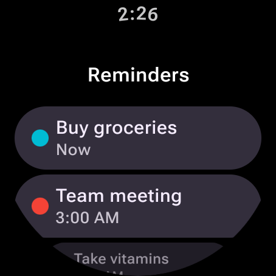
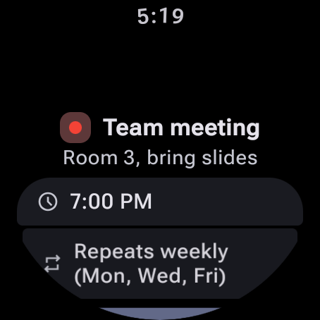
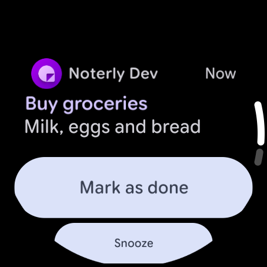
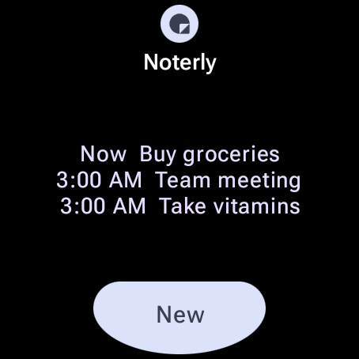

# Noterly Watch

**English** | [한국어](README.ko.md)

A Galaxy Watch (Wear OS) app for the [Noterly](https://github.com/lhh9799/noterly) phone app. Get your reminders on
your wrist, mark them as done or snooze them, and add new ones without taking out your phone.

> A **personal fork** based on the original [Noterly](https://github.com/tomc128/noterly) by Tom Chapman (TDS Studios).
> It is not affiliated with TDS Studios. See [License](#license).

<p>
  
  
  
  
</p>

## Features

- **Reminder list**: shows the same reminders as the phone, grouped like the phone into Shown immediately, Scheduled and
  Repeating, each ordered by when they notify next. Repeating reminders also show their next few times.
- **Watch notifications**: the watch notifies with a vibration at the set time by itself, even when the phone is far
  away or switched off.
- **Done and snooze**: act on a reminder from its notification or its details screen, and the phone is updated too. A
  repeating reminder moves on to its next time.
- **Add and edit**: set the title, the time (none means notify now), the repeat (daily, weekly, chosen days of the
  week and more) and the colour on the watch.
- **Archive**: see reminders you have finished, and restore or delete them.
- **Tile and complication**: check the next reminder from the watch face and a tile.
- **Offline**: what you do on the watch while the phone is disconnected is kept and applied to the phone once it
  reconnects.

## Good to know

- **The Noterly phone app is required.** The watch app installs without it, in any order, but the phone app holds the
  reminders: without it the list stays empty and reminders added on the watch are not saved.
- The phone and watch apps only connect when they are signed with the same key. Use these versions together
  (latest: phone app **v1.16.1**, watch app **v1.1.0**, as of 2026-11-24):

  | Watch app | Compatible phone app |
  |---|---|
  | v1.1.0 | v1.8.1, v1.8.2, v1.9.0, v1.10.0, v1.11.0, v1.12.0, v1.12.1, v1.13.0, v1.14.0, v1.15.0, v1.15.1, v1.15.2, v1.16.0, v1.16.1 |
  | v1.0.1 | v1.8.1, v1.8.2, v1.9.0, v1.10.0, v1.11.0, v1.12.0, v1.12.1, v1.13.0, v1.14.0, v1.15.0, v1.15.1, v1.15.2, v1.16.0, v1.16.1 |
  | v1.0.0 | v1.7.0, v1.8.0 |
- With the watch app installed, phone notifications are not copied to the watch; only the notifications the watch app
  shows itself appear.
- Tested on Wear OS 6 (Galaxy Watch 8) and newer.

## Install (without a PC)

1. Phone: download the phone APK from the latest
   [Noterly release](https://github.com/lhh9799/noterly/releases/latest) and install it (the first time, allow your
   browser or file app to install unknown apps).
2. On the phone, download the watch APK (`noterly-watch-*.apk`) from this repository's
   [Releases](https://github.com/lhh9799/noterly-watch/releases).
3. Watch: go to Settings → About watch → Software information and tap Software version 7 times to turn on Developer
   options. In Developer options, turn on ADB debugging and Wireless debugging. The phone and the watch must be on the
   same Wi-Fi network.
4. On the phone, install a watch app installer from the Play Store (for example Wear Installer 2 or Bugjaeger). Pair it
   with the code and IP:port shown under "Pair new device" in the watch's Wireless debugging, then choose the watch APK
   to install it on the watch.
5. Once it is installed, you can turn ADB debugging and Wireless debugging off again on the watch.

---

# For developers

The spec is in [docs/Noterly 워치 앱 명세서.md](docs/Noterly%20워치%20앱%20명세서.md) (in Korean).

## Tech stack

- Kotlin 2.3, Gradle (AGP 8.13), Android SDK 36
- Jetpack Compose for Wear OS Material 3 1.5
- Wear Tiles / ProtoLayout, Watch Face Complications
- Wearable Data Layer (play-services-wearable): DataClient, MessageClient, CapabilityClient
- Jetpack DataStore, kotlinx.serialization (JSON), Kotlin Coroutines
- AlarmManager exact alarms, NotificationCompat
- Phone side: the Flutter (Dart) app with the local Android plugin `noterly_wear` (handles watch commands in a
  background Flutter engine)

## Structure

```
noterly-watch/
  wearshared/   snapshot and command data classes, Data Layer paths, repeat calculation (ported from Dart),
                overlay of pending commands. Plain Kotlin (JVM)
  wear/         the watch app (Compose for Wear OS Material 3, tile, complication)
```

The phone-side changes (updatedAt and rev, sending snapshots, handling commands) are on `main` of the
[noterly](https://github.com/lhh9799/noterly) repository.


## How it works

- The phone is the only source of truth. Every time it saves, it sends the whole list as the `/noterly/snapshot`
  DataItem.
- The watch sends each change it wants as a `/noterly/cmd/{commandId}` DataItem. While disconnected it stays on the
  watch and is delivered on reconnecting; the phone deletes it once applied.
- The watch shows the last snapshot with the commands the phone has not handled yet laid on top. Commands listed in the
  snapshot's `appliedCommands` are dropped from the queue.
- When the watch app starts and when the phone reconnects, the watch asks for the latest snapshot with a
  `/noterly/sync-request` message.
- The watch sets an exact alarm for each active reminder's next time and shows the notification itself, whether or not
  the phone is connected. Reminders without a time, or whose time has passed, are shown once as soon as they are saved,
  like on the phone. Phone notifications are kept from reaching the watch (NO_BRIDGING) so nothing rings twice. Done
  and snooze on a watch notification are sent to the phone as commands.


## Build

Requires Android Studio (or the Android SDK 36).

```
./gradlew :wear:assembleDevDebug        # for local testing
./gradlew :wear:assembleDevRelease
./gradlew :wear:assembleProductionRelease
```

- **The applicationId and signature must match the phone app** for the Data Layer to connect. The phone's release APK
  is the `dev` flavour (`uk.co.tdsstudios.noterly.dev`), so install `dev` on the watch too.
- Release signing: put `noterly.keyProperties=<noterly>/noterly/android/key.properties` in `local.properties` or
  `~/.gradle/gradle.properties` to sign with the same key as the phone. Without it, the build is signed with the local
  debug key like the phone app, which matches when both are built on the same PC.
- Install: over Wi-Fi ADB with `adb -s <watch> install wear/build/outputs/apk/dev/release/wear-dev-release.apk`

To test only the shared module without the Android SDK:

```
./gradlew -Pnoterly.sharedOnly :wearshared:test
```

The repeat test cases (`wearshared/src/test/resources/recurrence_cases.json`) are the same file as
`noterly/test/recurrence_cases.json` in the phone repository, to check that Dart and Kotlin give the same results.


## Branches

`main` (releases) ← `develop` ← `feature/*`. Features are built on feature branches and merged into `develop` with
`--no-ff`.


## Differences from the spec

- The watch app lives in this repository, not as a module of the phone repository. The phone-side channel code is in a
  local plugin (`noterly/packages/noterly_wear`) instead of `android/app`: as a plugin, the channel is also registered
  in the background Flutter engines that handle notification buttons and watch commands.
- The spec had the watch notify only while the phone is disconnected and otherwise take over the phone's notifications.
  But the Galaxy Watch does not forward phone notifications while the phone is in use, so notifications were missed.
  The watch therefore always shows notifications itself, and forwarding from the phone is turned off (NO_BRIDGING).
- Like the phone, the watch's own notification rings once per reminder (at the end of a snooze or at its dateTime); the
  next repeat is scheduled after it is marked as done. `upcoming` is used for display and for working out reminders
  whose repeat was changed on the watch.
- `appliedCommands` (IDs of recent commands the phone applied or ignored) was added to the snapshot, so the watch knows
  when to drop a pending command.
- The app's text follows the watch's language: English, or Korean (`values-ko`, worded like the phone app's Korean
  translation). Translations were a non-goal in the spec and were added later. As in the spec, a reminder's repeat
  description comes from the phone, in the phone app's language; the watch words it itself only for a repeat changed on
  the watch. Korean lines break only between words (phrase line breaking in the theme's text styles).


## License

Licensed under the [GNU Affero General Public License v3.0](LICENSE) (AGPL-3.0), the same licence as the original
Noterly.

This watch app takes the following from the original [Noterly](https://github.com/tomc128/noterly)
(Copyright © 2023 Tom Chapman, TDS Studios, AGPL-3.0):

- The app and notification icons (`ic_launcher*` and `notification_icon_48` in `wear/src/main/res`), used as they are.
- The repeat calculation (`Recurrence.kt` in `wearshared`), ported to Kotlin from the original Dart code
  (`lib/models/repetition_data.dart`). Repeats on days of the week are a rule added in
  [this fork](https://github.com/lhh9799/noterly).

The "Noterly" name and the `uk.co.tdsstudios` package name follow the original so that the watch app can connect to the
phone app (the Data Layer only connects apps with the same applicationId).
